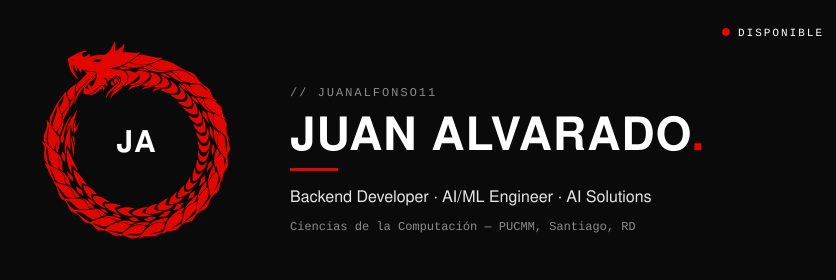

  

  
  <!-- Añade tus enlaces reales y quita los comentarios:
  
  
  -->

<picture>
  <source media="(prefers-color-scheme: dark)" srcset="assets/sec-01-dark.svg">
  
</picture>

Estudiante de último año de Ingeniería en Ciencias de la Computación en la PUCMM (Santiago, RD). Programo desde los 16, cuando empecé con C, C# y SQL; hoy me enfoco en backend e inteligencia artificial.

- **Ahora:** DriveSense (proyecto de grado) y JobFlow AI
- **Busco:** mi primer rol junior en Backend, AI/ML o AI Solutions, remoto o en Santiago

<picture>
  <source media="(prefers-color-scheme: dark)" srcset="assets/sec-02-dark.svg">
  
</picture>

<table>
  <tr>
    <td><code>LENGUAJES</code></td>
    <td>
      
      
      
      
      
      
      
    </td>
  </tr>
  <tr>
    <td><code>IA</code></td>
    <td>
      
    </td>
  </tr>
  <tr>
    <td><code>HERRAMIENTAS</code></td>
    <td>
      
      
      
      
    </td>
  </tr>
</table>

<picture>
  <source media="(prefers-color-scheme: dark)" srcset="assets/sec-03-dark.svg">
  
</picture>

| Proyecto | Qué hace |
|---|---|
| [**Mesa Commander**](https://github.com/JuanAlfonso11/mesa-commander) | Mesa libre de Commander (Magic: The Gathering) en español para móvil y PC: partidas contra bots, gestión de mazos y multijugador en línea por WebRTC. |
| [**SpendTrack**](https://github.com/JuanAlfonso11/spendtrack) | Finanzas personales: ingresos, gastos, tarjetas, metas e inversión. Importa estados del Banco Popular y guarda los datos solo en el teléfono. |
| **JobFlow AI** | App de búsqueda de empleo con IA. *(privado)* |
| **Profesor IA** | App de estudio para Android con Ollama y Obsidian. *(privado)* |
| **DriveSense** | Proyecto de grado, en desarrollo. *(privado)* |

<picture>
  <source media="(prefers-color-scheme: dark)" srcset="assets/sec-04-dark.svg">
  
</picture>

  
  

  <picture>
    <source media="(prefers-color-scheme: dark)" srcset="https://raw.githubusercontent.com/JuanAlfonso11/JuanAlfonso11/output/snake-dark.svg">
    
  </picture>

<picture>
  <source media="(prefers-color-scheme: dark)" srcset="assets/footer-dark.svg">
  
</picture>
